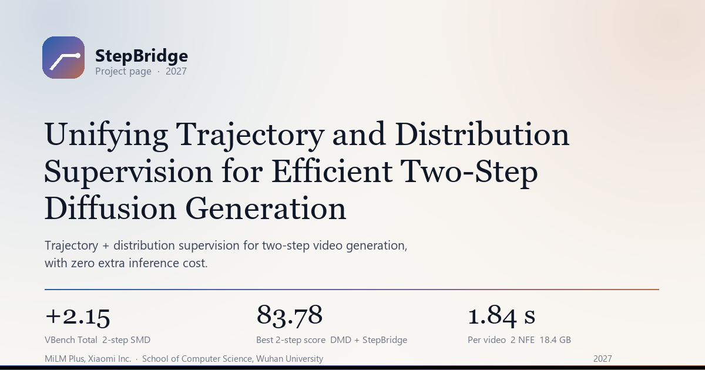

<div align="center">



<br>

# StepBridge · Project Page

**Unifying Trajectory and Distribution Supervision for Efficient Two-Step Diffusion Generation**

[](https://visualgenmi.github.io/StepBridge-Page/)
[](https://github.com/VisualGenMi/StepBridge)
[](#local-preview)
[](#repository-layout)
[](#automated-checks)

A single-page, dependency-free project site for a two-step video diffusion paper.
Open `index.html` and it runs — no framework, no bundler, no server-side code.

</div>

---

## Contents

- [Highlights](#highlights)
- [Local preview](#local-preview)
- [Deployment](#deployment)
- [Repository layout](#repository-layout)
- [What to edit](#what-to-edit)
- [Design notes · the video wall](#design-notes--the-video-wall)
- [Design notes · the two 3D figures](#design-notes--the-two-3d-figures)
- [Design notes · the emblem](#design-notes--the-emblem)
- [Design notes · the abstract flowchart](#design-notes--the-abstract-flowchart)
- [Engineering notes](#engineering-notes)
- [Automated checks](#automated-checks)
- [Credits](#credits)

---

## Highlights

| | |
| --- | --- |
| **Live site** | <https://visualgenmi.github.io/StepBridge-Page/> |
| **Paper** | Not published yet — the only PDF in hand is the anonymous review version, which carries a *confidential* header on every page and is therefore kept out of this repository |
| **Code** | <https://github.com/VisualGenMi/StepBridge> (being prepared for release) |
| **Video wall** | 15 side-by-side comparisons, six on screen at once, uncropped |
| **3D figures** | Two hand-written Canvas 2D scenes — no WebGL, no three.js |
| **Payload** | ~50 MB of video, everything else under 500 KB |

---

## Local preview

Any static server works. Python is the shortest path:

```powershell
cd StepBridge-Page
python -m http.server 8899 --bind 127.0.0.1
# then open http://127.0.0.1:8899/
```

On Windows you can also just double-click `serve.cmd`.

> Opening `index.html` straight from the filesystem mostly works, but the JSON
> playlist and the video range requests behave better over `http://`.

### Deep links for screenshots

The page accepts URL parameters. They exist so that a specific frame can be
reproduced and shared, which is handy when sending a figure to a co-author.

| Parameter | Effect |
| --- | --- |
| `?theme=light` | Force the light theme for this visit |
| `?steps=2` | Pin the step-compression corridor on the two-step stage |
| `?arch=0.55` | Freeze the architecture timeline at 55 % (any value in `0`–`1`) |

---

## Deployment

The site is served by **GitHub Pages** from the `main` branch, repository root.

### Publishing an update

```powershell
cd StepBridge-Page
git add -A
git commit -m "update: what changed"
git push
```

Pages rebuilds automatically; the new version is live in about a minute.

### First-time setup (already done here)

1. Create the repository under the organisation.
2. `git remote add origin https://github.com/VisualGenMi/StepBridge-Page.git`
3. `git push -u origin main`
4. **Settings → Pages** → Source `Deploy from a branch` → Branch `main`, folder `/ (root)`.

The free organisation plan only serves Pages from **public** repositories, which
is why this repository is public while the code repository stays separate.

`.nojekyll` sits in the root so that Jekyll does not reinterpret `assets/`.

### Adding collaborators

Organisation → **People → Invite member** (role *Member* to push, *Owner* to
change settings). Every repository in the organisation then inherits access,
which is simpler than adding collaborators one repository at a time.

### Alternatives

| Option | How |
| --- | --- |
| No Git client | Upload `index.html` + `assets/` through **Add file → Upload files** |
| Drag and drop | Drop the folder on <https://app.netlify.com/drop> |
| Custom domain | Pages → Custom domain, plus a `CNAME` file in the root |

---

## Repository layout

```
StepBridge-Page/
├── index.html                 # the whole page: hero, 7 sections, JSON playlist
├── serve.cmd                  # one-click local server on Windows
├── .nojekyll                  # keep Jekyll out of assets/
├── assets/
│   ├── css/style.css          # base layout, hero, 3D containers, authors, role cards
│   ├── css/cinema.css         # the comparison wall
│   ├── css/results.css        # gap-recovery bars + switchable tables
│   ├── css/flow.css           # abstract reading-guide flowchart
│   ├── css/hero.css           # emblem, wordmark, tagline
│   ├── js/main.js             # theme, nav state, table filter, lightbox, BibTeX copy
│   ├── js/steps3d.js          # 3D step compression (Canvas 2D)
│   ├── js/arch3d.js           # 3D three-rail architecture (Canvas 2D)
│   ├── js/cinema.js           # comparison wall playback and paging
│   ├── figures/               # paper figures, WebP
│   ├── posters/               # 15 first-frame posters
│   ├── videos/                # 15 comparisons, 1664×536, uncropped
│   ├── og.png                 # social preview card (1200×630)
│   └── favicon.svg
└── tools/                     # asset builders and headless-browser checks
    ├── build_videos.py        # regenerate the #videoData playlist
    ├── build_table.py         # regenerate the VBench tables
    ├── restore_videos.py      # restore full-frame videos and posters
    ├── trim_caption.py        # alternative: crop the baked title row
    ├── render_figures.py      # paper figure PDF → PNG
    ├── make_og.py             # rebuild the social preview image
    ├── qa.mjs                 # 38 end-to-end checks over CDP
    ├── test-steps.mjs         # 10 checks for the step-compression canvas
    ├── test-perf.mjs          # frame-rate and reduced-motion checks
    └── shot.mjs               # element-level screenshots
```

---

## What to edit

Everything a reader sees lives in `index.html`. The table below points at the
blocks that change most often.

| Content | Where |
| --- | --- |
| Authors and affiliations | `.authors`, `.affil`, `.authors__note` (the `*` / `†` legend) |
| Title, subtitle, tagline | `.hero__lockup`, `h1`, `.hero__sub`, `.hero__tagline` |
| Call-to-action buttons | `.cta-row` — swap the `Paper` placeholder for a real `href` once a public PDF exists |
| Abstract text | `.abstract-text` inside `#abstract` |
| BibTeX | the `<pre id="bibtex">` block in `#citation` |
| Social preview | `assets/og.png` (1200×630) and the `og:image` / `twitter:image` tags |
| Video playlist | `tools/build_videos.py` (`ORDER`, `TITLES`) → writes `#videoData` |
| VBench tables | `tools/build_table.py` (`ROWS`, `RANKS`) |
| 3D animation numbers | `STAGES` in `assets/js/steps3d.js`, `RAILS` in `assets/js/arch3d.js` |

### Rebuilding assets

```powershell
pip install pymupdf pillow imageio-ffmpeg
python tools/render_figures.py    # paper figures -> assets/figures/*.webp
python tools/restore_videos.py    # full-frame videos + posters (source: ../videos_original)
python tools/build_videos.py      # refresh the playlist JSON
python tools/make_og.py           # social preview card
```

---

## Design notes · the video wall

The video wall sits in the **hero**, directly under the title, where a static
teaser figure used to be. For a video paper the first screen should move.

**What it does**

- **Six pairs at once** in a 3 × 2 grid; the 15 clips form 3 sets of 6.
- Sets advance every 7.8 s, or on click / arrow keys.
- The last set wraps around to the front of the list, so the wall is **never
  partially empty** — 15 is not a multiple of six.
- Each cell is a left/right baked comparison: `ORIGINAL` on the left,
  `+ STEPBRIDGE` on the right, same prompt and same seed.
- Videos are **never cropped**: `object-fit: contain` inside a 4 px warm-white
  mat, with the baked title row kept at its original brightness.
- The card footer carries only `title + model + method`; the expand button
  appears on hover and opens a full-size lightbox.
- Copy is compressed into one status line:
  `Same prompt, same seed · left: base two-step · right: + StepBridge · click any pair to enlarge`
  with a progress bar for the current set on the right.
- Responsive: 2 columns below 1100 px, a single column below 700 px, and on
  phones a *set* is 2 clips rather than 6 so the abstract does not get pushed
  several screens down.
- Plays only while visible, pauses in background tabs, and under
  `prefers-reduced-motion` it shows the first frame and stops advancing.

**Two traps worth remembering**

1. **Never overlay the baked title row.** An earlier build added a dark
   gradient scrim over the top 15 % of each cell to calm the white bars down.
   The baked bar is ~13 % of the frame, so the scrim landed exactly on it and
   turned crisp dark text into grey mush — it read as two layers stacked on top
   of each other. The scrim is gone; the bar keeps its own contrast.

2. **Bump the cache version when assets change in place.** Videos are
   re-encoded under the same filenames, so browsers happily keep serving the
   old bytes. `cinema.js` appends `?v=…` to video and poster URLs, and
   `index.html` version-tags its CSS/JS. Increment both when replacing media.

---

## Design notes · the two 3D figures

Both figures are drawn by hand into a `<canvas>` with a small perspective
projection (`s = focal / (dist − z)`). There is no WebGL and no 3D library.

### Step compression (`assets/js/steps3d.js`)

A corridor threading the latent space. Each ring is one network evaluation:
50 dense rings for the teacher, 4 for the reference, 2 for the student — where
two rings also raise a dashed arch to mark the endpoint anchor. The
`50 ⟶ 4 ⟹ 2` strip below doubles as a legend and a stage selector (clicking
pins a stage for 14 s; arrow keys work too).

### Three-rail architecture (`assets/js/arch3d.js`)

Four questions were answered before any pixel was drawn:

| | Content | How it is drawn |
| --- | --- | --- |
| Input | prompt `c` plus two **independently sampled** noises `z_S, z_A` | two jittering particle clusters at the left end; a bowed arrow labelled `4-step ckpt` links the reference start to the student start |
| Alignment ① (trajectory, **two-way**) | the student proposes **key states**; the teacher returns the **velocity there** | violet dashed beam upward (student → teacher, arrowhead at the teacher), solid blue beam downward (teacher → student, arrowhead on the student), bowed in opposite directions so the loop is legible |
| Alignment ② (distribution) | `p_θ → p_A` with **no sample correspondence** | endpoints open into sample clouds, linked by **shuffled** pair lines; after anchoring the violet cloud settles onto the warm one |
| Output | `x̂ = G_θ(z_S, c)` at 2 NFE | a single point at the end of the student rail, labelled `x̂ / 2 NFE`; only the student rail is a solid ribbon |

**How "interval velocity" is made visible** — the core idea of the figure:

1. Two windows per coarse step (six in total) open from a point into a segment
   of width `w` as the light travels through them.
2. Above each window a **secant with an arrowhead** is drawn: the student's mean
   velocity over that interval, `v̄_S = (x̂(α+w) − x̂(α)) / (wΔσ)`. Heights
   alternate so neighbours never overlap; only the first window of each group
   carries the `mean over w` label.
3. What the student hands over is the **window midpoint** — not the start, not
   the end — and the violet arrow lands on the teacher rail.
4. The teacher's answer comes back as a blue solid beam that lands on that same
   midpoint.
5. Teacher ticks light up **only within a queried window**; outside it they stay
   dim, so the teacher never reads as running its own trajectory.

The point-supervision → interval-supervision distinction therefore needs no
prose: the target is visibly a chord spanning `w`, not a tangent at a point.

**One clock.** All three rails — including the four-step reference — share the
same `u`, the σ = 1 → 0 progress. The student crosses in **two big strides**
while the reference moves almost uniformly: same elapsed time, same path,
different step counts.

**Beat of the loop.** Noise inputs and the `4-step ckpt` flash → first stride,
windows open, both beams fire → second stride repeats → both rails reach σ = 0
together → clouds open, anchor band lights, clouds converge → repeat.

**Perspective floor.** A grid under the rails — lines parallel to the rails plus
cross lines converging on the vanishing point — fades with depth, with a soft
pool of light in the middle. It gives the three rails a ground plane instead of
floating them on black.

**Caption.** One paragraph, `Top:` for steps and gates, `Bottom:` for interval
windows and two-way supervision. Justified with a flush-left last line on
desktop, and switched back to left-aligned below 700 px where justification
opens ugly word gaps.

---

## Design notes · the emblem

One sentence: **a rise plus a flat run = two steps; a dashed chord = endpoint
anchoring.**

| Element | Meaning |
| --- | --- |
| A few scattered dots at the left | Gaussian noise (σ = 1), not yet formed |
| A steep blue segment | Step 1: crossing most of the trajectory |
| A small ring at the elbow | The only retained intermediate state (two steps have one) |
| A warm horizontal run | Step 2: from the intermediate state to the endpoint |
| A thin dashed chord | Endpoint anchoring: the landing constraint from the frozen four-step reference |
| A glowing dot at the right | Clean latent (σ = 0) |
| Orbiting ring text | `TWO-STEP · TRAJECTORY + DISTRIBUTION` |
| Blue → violet → warm gradient | The same palette as the body text, 3D figures and table highlights |

Hard rules that came out of the iterations:

1. **Exactly two segments.** Never a W-shape with three or four strides — that
   would silently contradict the "two-step" claim.
2. The elbow is deliberately wide (~60°) so the rise-then-run reading survives
   at 24 px.
3. The chord must be **dashed and thinner**, otherwise it reads as a second
   trajectory rather than a constraint.
4. The endpoint is a glowing dot, so it still reads as a landing point once
   detail is lost.
5. Ring text carries method keywords only — the full name turns to mush.

Where it appears: the 100 px emblem in the hero, a 40 × 40 simplified version in
the navigation bar, and the same mark in the favicon and `assets/og.png`.

Implementation: inline SVG on a 120 × 120 grid, no image dependency. Ring text
is laid out with `<textPath>` and rotated once per 44 s; the polyline draws
itself in with `stroke-dasharray` over 2.6 s; the endpoint glow uses a radial
gradient and a breathing `scale`; noise dots blink out of phase. All of it stops
under `prefers-reduced-motion`.

---

## Design notes · the abstract flowchart

The right column of the abstract used to be empty. It now holds a vertical
flowchart that translates the abstract, sentence by sentence, into four stages:

| Stage | Abstract sentence it mirrors |
| --- | --- |
| ① The constraint | "…under a severely limited sampling budget" |
| ② Multi-step teacher / few-step generator | "…may not fully align with the student's compressed sampling process" / "…lacks explicit guidance on the student's generation trajectory" |
| ③ StepBridge | "…combine trajectory-level and distribution-level supervision", with `L_OPD` and `L_DMD` listed |
| ④ Coordination | "…adaptive gradient scaling and asymmetric gradient projection" |

The same ① ② ③ ④ marks are embedded as small dots in the abstract prose.
Hovering or focusing a dot lights the matching card; clicking scrolls the card
into view and pulses it. Wires are animated dashed SVG paths, static under
`prefers-reduced-motion`.

The column is `position: sticky`, so it stays visible while the abstract
scrolls. Below 980 px it collapses to a single column and moves **above** the
abstract, so readers see the diagram before the text.

---

## Engineering notes

- **Palette** comes from the paper: `#285FA6` (bridge blue), `#6A63A8`
  (transition violet), `#B86B4B` (bridge warm). Table highlights reuse the
  paper's red / blue / green semantics.
- **Type**: Instrument Serif for display, Inter for body, JetBrains Mono for
  code, with Georgia and the system stack as offline fallbacks.
- **The abstract** is justified and capped at 70 ch to keep line lengths
  readable.
- **Paper Figure 2** is a white-background illustration, so it is wrapped in a
  "sheet of paper" card (warm off-white, click to enlarge) rather than pasted
  as a raw image.
- **The formula card** stays dark in both themes so the contrast never breaks.
- **Both 3D canvases** use palette-independent colours, so switching themes
  needs no re-render logic.
- **Initial paint** loads fonts plus a single image; videos and posters are
  lazy and only start when the wall scrolls into view.

---

## Automated checks

The QA scripts drive a real Chrome over the DevTools protocol, so they catch
layout and runtime problems that a static lint cannot.

```powershell
npm i puppeteer-core          # or use any local Chrome
node tools/qa.mjs https://visualgenmi.github.io/StepBridge-Page/
node tools/test-steps.mjs http://127.0.0.1:8899/
node tools/test-perf.mjs  http://127.0.0.1:8899/
```

| Suite | Covers |
| --- | --- |
| `qa.mjs` — 38 checks | title, playlist, wall layout and autoplay, paging, tables, theme, lightboxes, anchors, console errors, asset 200s, overflow at 1440 px and 390 px, mobile menu |
| `test-steps.mjs` — 10 checks | stage cycling, `?steps=` deep link, HUD numbers, canvas painting |
| `test-perf.mjs` | animation frame-rate under load, `prefers-reduced-motion` behaviour |

`tools/shot.mjs <url> <w> <h> <out.png> <selector> <theme> <scrollTo> <waitMs>`
captures a single element, which is how the figures in this repository were
reviewed.

---

## Credits

- Method, figures and numbers come from the paper's own LaTeX sources and
  appendix tables (main results: Table 1; diversity: Table 2; ADV and rCM:
  Table S1; 14B: Table S3).
- Videos were generated at 2 NFE; each clip pairs the base two-step student
  (left) with its StepBridge counterpart (right) under identical prompt and seed.
- Figures and videos remain © the paper's authors. The page code is free to
  reuse.
